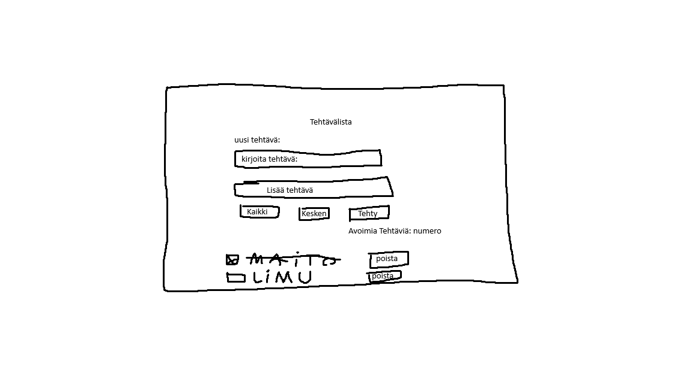
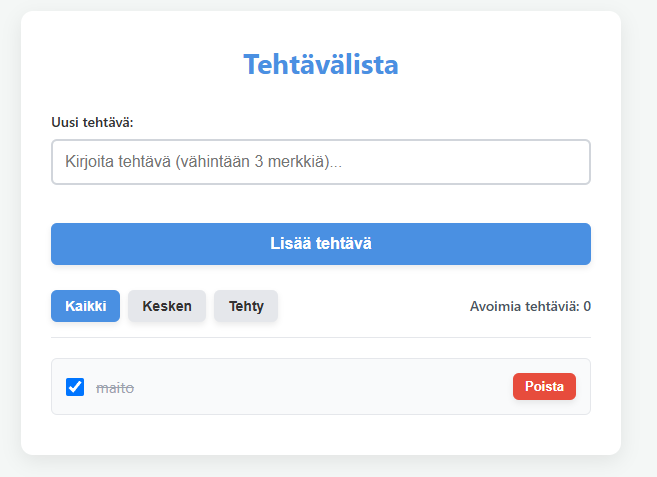

# Tehtävälista
**Author(s):** Jesse Mitronen.
## Projektisuunnitelma

### projektin idea
Projektin tarkoituksena on luoda helppokäyttöinen ja selkeä selaimessa toimiva Tehtävälista-sovellus. Sovellus on suunniteltu kaikille, jotka haluavat hallinnoida jokapäiväisiä tehtäviään, seurata niiden edistymistä ja pitää kirjaa tekemättömistä töistä.

### Suunnitellut toiminnot
- Toiminto 1 (Syötteen validointi): Käyttäjän syöte tarkistetaan. Tyhjät tai liian lyhyet tehtävät hylätään, ja sovellus näyttää virheilmoituksen sekä korostaa kentän punaisella reunuksella.
- Toiminto 2 (Tietojen tallennus selaimen muistiin): Tehtävät tallennetaan selaimen localStorage-muistiin, jotta ne säilyvät, vaikka sivu ladataan uudelleen.
- Toiminto 3 (Suodatus ja laskuri): Käyttäjä voi suodattaa näkyviä tehtäviä (Kaikki, Kesken, Tehty) ja nähdä reaaliaikaisen laskurin avoinna olevien tehtävien määrästä.

### Rautalankamalli / luonnos

## Verkkolinkit

- **Julkaistu sovellus:** [Lisää tähän GitHub Pages -osoite](https://jezzze.github.io/DOM-project/)
- **GitHub-repositorio:** [Lisää tähän repositorion osoite](https://github.com/jezzze/DOM-project)
- **Projektin videoesittely:** [Lisää tähän videon osoite](https://www.youtube.com/watch?v=yUqFgf1lZ24)

## Tietoja sovelluksesta

**[Tehtävälista]** on verkkosovellus, joka toimii helppokäyttöisenä ja selkeänä tehtävälistana Sovelluksen tarkoituksena on auttaa käyttäjiä hallitsemaan jokapäiväisiä tehtäviään, seuraamaan niiden edistymistä reaaliaikaisen laskurin avulla sekä suodattamaan tehtäviä tarpeen mukaan suoraan selaimessa.
## Teknologiat

- HTML – sivun rakenne
- CSS – ulkoasu ja asettelu
- JavaScript – toiminnallisuus, DOM-skriptaus ja lomakkeiden validointi
- localStorage – tietojen tallentaminen selaimeen, jotta tehtävät säilyivät sivun uudelleenlatauksen jälkeen.

## Sovelluksen käyttö

Kirjoita lyhyet käyttöohjeet sovellukselle.

1. Avaa julkaistu sovellus yllä olevasta linkistä.
2. Täytä lomakkeen kentät.
3. Lisää, muokkaa, poista tai merkitse kohteita tehdyiksi.
4. Päivitä sivu ja tarkista, säilyvätkö tiedot selaimessa, jos käytit localStoragea.

## Sovelluksen käynnistäminen paikallisesti

1. Kloonaa tai lataa tämä repositorio omalle koneellesi.
2. Avaa projektikansio.
3. Avaa `index.html` selaimessa.

## Kuvakaappaukset

## Tunnetut virheet / puutteet
**Ei tunnettuja virheitä.**

## Oma arvio ja oppimisen reflektointi

Pohdi työtäsi ja oppimisprosessiasi.

- Missä onnistuin? Onnistuin rakentamaan toimivan to-do listan itse ilman ulkoisia kirjastoja. 
- Mikä oli haastavaa? Haastavinta oli tilanhallinta natiivilla javascriptillä eli sen varmistaminen että suodattimet, laskurit, tallennus ja dom päivitykset synkronoituvat aina kun tehtäviä lisätään, poistetaan ja merkitään tehdyksi.
- Mitä parantaisin, jos aikaa olisi enemmän? jos aikaa olisi enemmän lisäisin vielä kyvyn muokata tehtäviä ja ehkä drag and drop tyylisen muokkauksen että voi liikutella tehtäviä listassa.
- Mitä opin HTML:stä, CSS:stä, JavaScriptistä ja DOM-skriptauksesta? HTML: opin luomaan jäsennellyn ja semaattisen lomakkeen sekä listarakenteen suorituskykyisesti. css: opin hyödyntämään css-muuttujia esmi. root:, flexbox asettelua sekä parantamaan ulkonäköä varjoilla ja animaatioilla javascript ja dom: opin addeventlistner, createelement ja filter, map hyödyntämistä käytännön sovelluksessa.
- Mikä jäi epäselväksi tai mistä haluaisin oppia lisää? Ei nyt mitään.
- Oma arvio projektista: **10/10 pistettä**

## Lähteet ja kiitokset

Listaa kaikki projektissa käyttämäsi lähteet, tutoriaalit, kuvat ja koodiesimerkit.

Jos käytit ChatGPT:tä, GitHub Copilotia tai muuta tekoälytyökalua, mainitse se tässä ja kerro lyhyesti, miten se tuki työskentelyäsi.

- [Lähteen tai tutoriaalin nimi] Jesse Mitronen
- [Kuvalähde] Jesse Mitronen
- Käytetty tekoälytyökalu: Gemini
  - Miten työkalua käytettiin: korjasin pari kirjoitus virhe erroria.

  ## Lisenssi

Tämä projekti on lisensoitu MIT-lisenssillä.

